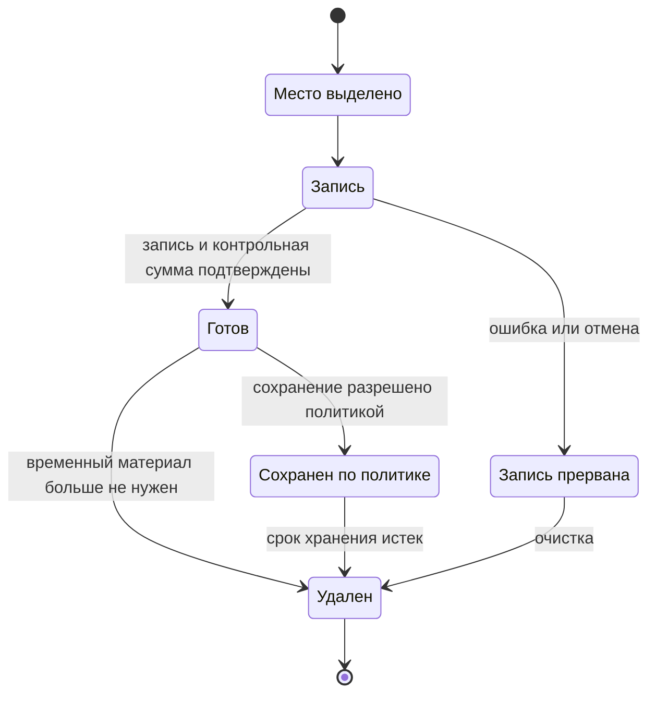

# Жизненный цикл материалов модуля

## 1. Обработка одного вызова

Материал поступает через разрешенную ссылку. После проверки создаются растры подготовленных страниц и необходимые производные изображения. Наблюдения и поля ссылаются на конкретные завершенные материалы. Незавершенная запись не публикуется как доступное изображение.

Состояния ниже относятся к локальному материалу.

## 2. Режимы хранения

| Материал | Рабочий режим | Экспериментальный режим |
|---|---|---|
| Исходный документ | Модуль не меняет и не назначает срок хранения внешнего оригинала | Версия и сумма фиксируются; доступ ограничен корпусом |
| Подготовленные изображения | Временные, если явно не разрешено диагностическое сохранение | Сохраняются по указанной политике для разбора ошибок и повторных измерений |
| Сырые наблюдения и кандидаты | Передаются в результате; отдельное постоянное хранение модулю не требуется | Сохраняются в защищенном наборе предсказаний |
| Поля | Выдаются вызывающей стороне | Сохраняются для расчета метрик, с тем же режимом защиты, что у исходников |
| Профиль, версия модели и оценщика | Неизменяемые ссылки и контрольные суммы | Сохраняются для воспроизведения |
| Агрегированные метрики | Без изображений и персональных значений | Могут использоваться в статье после проверки раскрываемой информации |

Область переданных результатов отделена от временных файлов операции. Растр, возвращенный Prepare, должен быть доступен следующим Probe и ExecuteProfile в пределах объявленного срока. Удаление после завершения Prepare касается только его временных файлов. Право освобождения переданного материала и срок доступности определяет вызывающий адаптер.

Временные каталоги разделены по вызовам. После отмены или аварийного завершения процессная среда удаляет оставшуюся область по заданному пределу хранения. Политика задает срок, доступ и ответственного; отсутствие согласованной политики запрещает диагностическое накопление реальных документов.

## 3. Происхождение

Цепочка связывает исходные байты, преобразования, OCR-наблюдения, кандидатов исправления и выбранное поле. Разные обрезки одного оригинала имеют общий lineage_root. Совпадение контрольной суммы помогает искать дубликаты, но не заменяет группировку разных фотографий одного документа или человека.

Изменение эталона не изменяет предсказания. Новая версия разметки и оценщика формирует новый расчет с сохранением исходного. Исправленный пример не удаляется из предыдущего результата эксперимента.

## 4. Кеш и повтор

Кешируемое вычисление связано с суммой реального входа, версией адаптера/модели, полными параметрами и режимом случайности. Кеш разрешается в пределах одинаковых полномочий. Для временных и ресурсных измерений кеш отключается либо измеряется отдельным вариантом. Запись о попадании в кеш обязательна.

Восстановление эксперимента сравнивает план пар и готовые записи. Неуспешные пары остаются в истории, а новый повтор получает новый ID.

## 5. Передача результатов исследования

Для повторного вычисления метрик сохраняются план, версии, предсказания, эталон, нормализация и оценщик. Полный повтор OCR дополнительно требует изображений, весов и соответствующей среды. Публикация изображений и весов возможна только при разрешенном использовании. Если реальный корпус закрыт, в статье прямо ограничивается доступный уровень воспроизведения; открытая синтетика не заменяет независимую проверку реальных данных.
