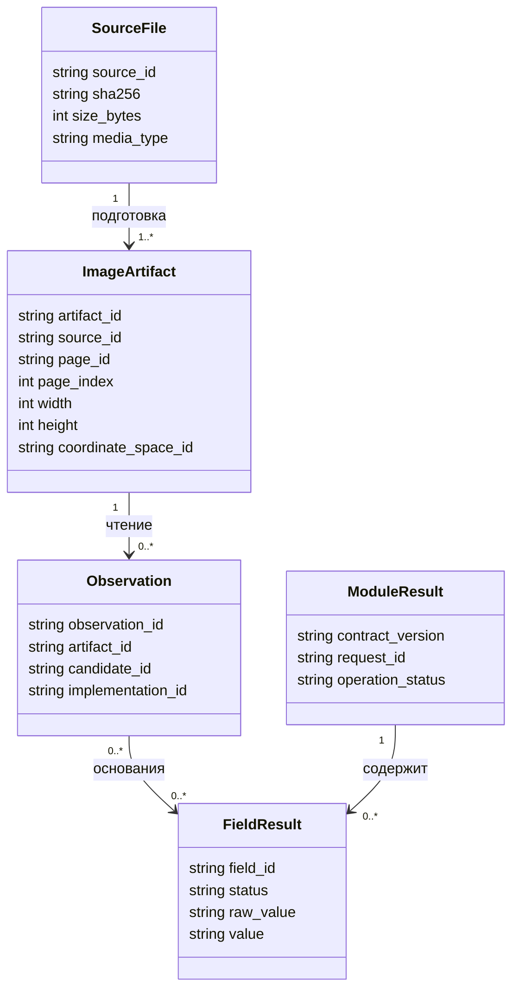

# Данные, поля и координаты OCR-модуля

## 1. Основные сущности

Модель описывает данные вычисления и эксперимента. Таблиц потребителей, дел, очередей и долговечных заданий здесь нет.



Кардинальность подготовленных материалов относится к успешно декодированному входу; при отказе материалы могут отсутствовать. Поля с отсутствующим значением описаны ниже; в сериализации используется null соответствующего формата.

## 2. Источник и материал

| Структура | Обязательные сведения | Правила |
|---|---|---|
| `SourceFile` | `source_id`, `source_ref`, `media_type`, `size_bytes`, `sha256` | Ссылка разрешается доверенным адаптером; тип, размер и сумма сверяются с фактическими байтами |
| `ImageArtifact` | `artifact_id`, `source_id`, `page_id`, `page_index`, `artifact_kind`, `sha256`, `width`, `height`, `channels`, `dtype`, `color_order`, `coordinate_space_id`, `parents`, `transforms` | Исходник не изменяется; каждое производное изображение указывает родителей |
| `PreparedPage` | `page_id`, `page_index`, `source_id`, `status`, `prepared_artifact`, `reason` | Индекс начинается с нуля и совпадает с порядком в исходном файле; для failed/not_processed изображение отсутствует |
| `ArtifactAccess` | Разрешенное обращение к материалу в текущем исполнении | Отдельно от постоянных метаданных; временные полномочия не входят в общие журналы |
| `AppliedExecution` | Версии кода, адаптеров, моделей и их контрольные суммы, политики, устройство, численные параметры, семена | Содержит фактическую конфигурацию, включая точную версию модели |

`artifact_id` идентифицирует конкретный материал. `recipe_hash` может дополнительно обозначать рецепт вычисления. Совпадение рецепта не гарантирует совпадение байтов недетерминированного вычисления; для содержимого всегда используется собственная контрольная сумма.

## 3. Системы координат

Начальное координатное пространство страницы относится к ее исходному декодированному либо растеризованному изображению. Для контейнера сохраняются индекс страницы, параметры растеризации, версия декодера и контрольная сумма полученного растра. Учет EXIF, нормализация ориентации и последующие операции образуют явную цепочку от этого изображения. Координаты растра не выдаются за единицы исходного контейнера.

Каждый растр имеет свою `coordinate_space_id`. Начало – верхний левый угол, x направлена вправо, y вниз. Для непрерывных координат границ изображение занимает `[0,W] × [0,H]`; центр пикселя `(i,j)` находится в `(i+0.5,j+0.5)`. Прямоугольник задается `[x0,y0,x1,y1)` с исключенной правой и нижней границей. Полигон содержит точки по обходу границы и не должен самопересекаться.

Для преобразования границ используется соглашение `p_target ~ H_source_to_target · p_source`. После умножения однородные координаты делятся на третью компоненту. Переход из координат границ в библиотечные координаты, где центр пикселя равен целому числу, требует сдвига на −0.5 по каждой оси; обратный переход – на +0.5. Адаптер обязан учитывать это явно. Направление матрицы, используемое функцией интерполяции, проверяется отдельно от обозначения H.

`TransformRecord` содержит `operation`, `from_space`, `to_space`, `matrix` либо описание нелинейного отображения, `parameters`, `interpolation`, `border_mode`, `output_size`, `valid_source_region`, `valid_pixel_mask_ref` при наличии отсутствующих пикселей и `implementation_ref`. Для поворотов и обрезок также сохраняется запись преобразования.

Матрица в цепочке применяется в порядке появления; для H1, затем H2 общее отображение равно H2·H1. Для обратного отображения используется обратная композиция, только если она определена. Нелинейное выпрямление не представляется фиктивной гомографией. Указанная обратимость координат не обещает восстановить потерянные после обрезки пиксели.

Поля и углы могут выходить за видимую область только как явно помеченная гипотеза. Пересечение с растром не должно стирать факт частичной видимости. Для перевода в целочисленную обрезку левую/верхнюю границу округляют вниз, правую/нижнюю вверх и фиксируют примененное ограничение размером растра.

## 4. Поиск документа

`ObjectCandidate` содержит `candidate_id`, `source_id`, `page_id`, `artifact_id`, `coordinate_space_id`, `bbox`, `polygon` либо null, `visible_corner_mask`, `form_hypotheses`, `raw_score`, `score_scale`, `implementation_ref`, `issues`.

Формы в проекте контракта обозначены `snils_card`, `adi_reg_2019`, `adi_reg_2023`. Коды используются для сопоставления форм в интерфейсе. Неизвестная форма не подставляется в один из этих кодов. Гипотезы имеют собственные оценки и `evidence_refs`.

`SearchResult.search_status`: `detected`, `not_detected`, `uncertain`. Он содержит `analysis_complete`, список кандидатов и диагностик. `not_detected` допустим только при завершенном анализе. Число кандидатов и неоднозначность выбора передаются отдельно. `FormResolution` содержит `resolved | ambiguous | unresolved | unsupported`, выбранный код либо null и альтернативы.

## 5. Качество

`QualityMeasurement`: `measurement_id`, `artifact_id`, `region`, `coordinate_space_id`, `metric_id`, `implementation_ref`, `measurement_scale`, `status`, `value`, `unit`, `reason`.

`status=measured` требует конечного значения в заявленной единице; `not_measured` требует null и причины. Диагностика дефекта содержит код, область и основания. При использовании уровня `good | acceptable | poor | unusable` обязательно указываются политика интерпретации и область оценки.

## 6. OCR-наблюдение и кандидат поля

`TextObservation` содержит `observation_id`, `artifact_id`, `candidate_id`, `text`, `region` либо null, `coordinate_space_id` при наличии региона, `raw_score` либо null, `score_scale` либо null, `alternatives`, `implementation_ref`.

`alternatives` – список реально доступных гипотез. Символьная позиция задается индексом Unicode-кодовой точки и отдельно связывается с областью изображения, если движок ее предоставляет. Пустой список означает отсутствие предоставленных альтернатив. Вероятность прочих символов по нему определить нельзя.

`FieldCandidate` содержит `candidate_value_id`, `field_id`, `document_candidate_id`, `raw_value`, `normalized_value`, `evidence_refs`, `corrections`, `normalizations`, `validations`, `lineage_root`. Любая ссылка на наблюдение должна относиться к тому же документу. Повторные чтения и разные преобразования одного растра сохраняют общий пиксельный источник.

## 7. Структурированные поля

`FieldResult` содержит `field_id`, `status`, `raw_value`, `value`, `selected_candidate_id`, `candidates`, `evidence_refs`, `corrections`, `normalizations`, `validations`, `confidence`, `issues`.

| Поле | Тип нормализованного значения | Ограничения |
|---|---|---|
| `snils` | Строка из 11 ASCII-цифр либо null | Ведущие нули не теряются; исходные разделители сохраняются в raw_value |
| `full_name` | Строка Unicode либо null | ФИО читается целиком; число слов не фиксируется; исходные буквы, включая U+0401/U+0451, сохраняются |
| `birth_date` | `YYYY-MM-DD` либо null | Это существующая календарная дата, однозначно связанная с полем рождения; неоднозначный порядок частей не угадывается |

Выбранное `value` обязано соответствовать типу поля. Наблюдение с десятью цифрами номера или невозможной календарной датой сохраняется в кандидате с исходным текстом и результатом проверки, но не сериализуется как корректное типизированное значение. Если ни одна поддержанная гипотеза не представима по схеме, выбранное значение отсутствует; возвращаются `unreadable` и причина `invalid_representation` либо `conflict` при нескольких неразрешенных гипотезах. Прохождение синтаксиса не обходит проверку контрольного числа и не подтверждает чтение.

Семантика состояний:

| `status` | `value` | Основание |
|---|---|---|
| `extracted` | Ненулевое | Выбрана представимая по схеме гипотеза; возможны отрицательные предметные проверки, например контрольного числа |
| `absent` | null | Поле применимо, соответствующая область осмотрена, значение отсутствует |
| `unreadable` | null | Чтение предпринималось, но подтвержденного значения недостаточно |
| `conflict` | null | Несколько гипотез не разрешены политикой |
| `not_applicable` | null | Неприменимость прямо следует из спецификации формы |
| `not_processed` | null | Поле не обрабатывалось, например из-за остановки; обязательна причина |

`not_processed` относится к внутренней схеме OCR-модуля. Адаптер интеграции не должен автоматически превращать его в `absent` или выдавать как поддерживаемое внешней схемой состояние без явного отображения.

`ValidationResult` содержит `rule_id`, `rule_version`, `status=valid | invalid | not_applicable | not_run`, `reason`, `input_candidate_ids`. Проверка номера применяется только к предусмотренному правилом диапазону. Версия и применимость алгоритма контрольного числа входят в профиль; правило не может подбирать замену цифр до случайного совпадения суммы.

`confidence` содержит `decision_score` либо null, `score_scale` либо null, `probability` либо null, `calibration_id` либо null, `calibration_scope` либо null. Непустая вероятность лежит в `[0,1]` и требует применимой калибровки. Отсутствие калибровки не заменяется средним OCR-score.

## 8. Пример одного поля

Синтетический пример структуры:

```json
{
  "field_id": "birth_date",
  "status": "extracted",
  "raw_value": "01.01.2000",
  "value": "2000-01-01",
  "selected_candidate_id": "candidate-date-demo",
  "candidates": ["candidate-date-demo"],
  "evidence_refs": ["observation-date-demo"],
  "corrections": [],
  "normalizations": [{"rule_id": "date-ddmmyyyy", "from": "01.01.2000", "to": "2000-01-01"}],
  "validations": [{"rule_id": "calendar-date", "rule_version": "1", "status": "valid", "reason": null, "input_candidate_ids": ["candidate-date-demo"]}],
  "confidence": {"decision_score": null, "score_scale": null, "probability": null, "calibration_id": null, "calibration_scope": null},
  "issues": []
}
```

Идентификаторы примера разрешаются внутри соответствующего результата исполнения. Для итоговой схемы поле `candidates` содержит ссылки на записи FieldCandidate.
