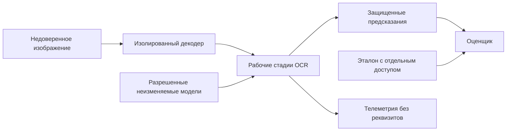

# Угрозы и границы доверия OCR-модуля

## 1. Область анализа

Защищаемые активы: исходный растр, распознанные реквизиты, промежуточные изображения, модель и профиль, эталон, предсказания и вычисленные метрики. Авторизация всего сервиса СИРД находится вне модели; рассматриваются ограниченные полномочия, переданные OCR.

## 2. Границы доверия

Граница растр–декодер ограничивает воздействие файла на процесс. Граница модель–исполнение ограничивает запуск непроверенного кода. Граница рабочая стадия–оценщик исключает подсказку правильного ответа. Граница материалы–общая телеметрия исключает перенос персонального содержимого в менее защищенную среду.

## 3. Угрозы и проверки

| Сценарий угрозы | Последствие | Ограничение | Проверка |
|---|---|---|---|
| Большой декодированный растр при малом файле | Исчерпание памяти | Отдельные пределы байтов, пикселей и памяти процесса | TEST-OCR-002 |
| Ошибка библиотеки декодирования | Доступ к данным процесса | Изоляция, минимальные полномочия, отсутствие сети | TEST-OCR-021 |
| Произвольный путь/URL источника | Чтение чужого файла или сетевого ресурса | Разрешенные MaterialRef и ограниченный адаптер | TEST-OCR-021 |
| Подмена весов или адаптера | Иная модель либо исполняемый код | Реестр, версии и контрольные суммы | TEST-OCR-017 |
| Инструкция в тексте документа для генеративной модели | Подмена полей или режима | Документ – данные; профиль и схема неизменяемы | TEST-OCR-013 |
| Реквизиты в исключении или трассировке | Утечка через журнал | Безопасные коды, тестовые маркеры и проверка журналов | TEST-OCR-021 |
| Эталон в каталоге OCR или подсказке | Недостоверное качество эксперимента | Отдельные процессы и полномочия, манифест без разметки | TEST-OCR-022 |
| Удаление неудобных результатов | Искаженный вывод статьи | Полный план пар, обязательные терминальные записи и суммы | TEST-OCR-020, TEST-OCR-023 |
| Кеш другой конфигурации | Неверное сравнение моделей | Ключ входа и разрешенной спецификации, учет cache hits | TEST-OCR-019 |

Частоты угроз не измерены. В первую очередь проверяются раскрытие персональных данных, неподтвержденная выдача полей и нарушение достоверности измерения. Эти сценарии могут блокировать приемочный вывод даже при хорошей средней точности.
