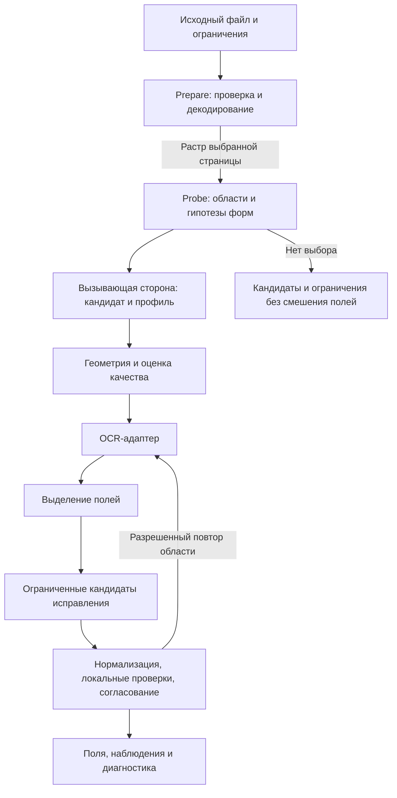

# Архитектура OCR-модуля

## 1. Граница

Модуль охватывает вычислительный путь от растрового изображения до наблюдений и структурированных полей. Для вызова достаточно разрешенного материала, профиля и ограничений. База СИРД, ее API, очередь, транзакции, учетные записи и управление долговечными заданиями в состав модуля не входят.

В интеграции сохраняются операции `Prepare`, `Probe`, `ExecuteProfile`. СИРД передает техническую политику, получает наблюдения формы и выбирает исполняемую спецификацию. Модуль не ведет независимо изменяемый предметный каталог. Его обработчики полей выполняют локальные функции извлечения, нормализации и проверки по переданным правилам; окончательная достаточность и публикация ответа остаются у вызывающей стороны.

Автономный экспериментальный исполнитель вызывает те же порты с зафиксированным набором профилей. Он может выполнять техническое разрешение гипотез в рамках этого набора; правила и их версия входят в вариант эксперимента. Версия набора неизменна в течение эксперимента.

## 2. Состав

Схема показывает вычислительные стадии и отдельного потребителя их результатов. Обратная связь ограничена профилем.

Компоненты, входы, выходы и конкретные способы проверки перечислены в [паспортах компонентов](views/components.md). Порты определены в [контрактах стадий](interfaces/internal-contracts.md).

## 3. Подготовка, локализация и геометрия

`Prepare` проверяет файл до дорогостоящей обработки и получает растры страниц разрешенным декодером. Проверяет пределы страницы, файла и суммарных пикселей; сохраняет индексы и полноту подготовки. Нормализует каналы и интерпретирует ориентацию метаданных ровно один раз. Оригинал остается неизменным. При растеризации контейнера сохраняются параметры масштаба, версия декодера и связь с исходной страницей. Размеры, число каналов, порядок цвета и система координат фиксируются в материале; случайная передача BGR вместо RGB выявляется контрактным тестом.

`Probe` возвращает все найденные кандидаты в пределах бюджета, их области, гипотезы форм и собственные оценки. Отсутствие обнаружения означает результат завершенного поиска. Физическое отсутствие предмета этим результатом не доказывается. Слабые признаки, слишком малый объект и незавершенный анализ возвращают ограничение. Несколько объектов не сокращаются молча до самого большого.

Геометрия выполняется по выбранному кандидату. Уменьшенная копия допустима для поиска, но преобразование применяется к исходному разрешению. Поворот на 90/180/270 градусов отделен от малого наклона текста. При четырех надежных углах допустимо перспективное преобразование. Ограничивающий повернутый прямоугольник дает ориентацию и область; он не восстанавливает истинную перспективу.

До преобразования проверяются порядок углов, отсутствие самопересечения, площадь, обусловленность и область доступных пикселей. При недостаточных основаниях профиль разрешает более простой вариант обрезки либо исходное изображение с ограничением. После преобразования проверяются потеря видимых целевых областей и корректность отображения координат. Поля вне кадра не дорисовываются.

Повторные повороты и изменение размера по возможности объединяются в одно отображение. Для каждой реально выполненной дискретизации сохраняются интерполяция, размер, заполнение границ и маска отсутствующих исходных пикселей. Увеличенный растр не получает фиктивного признака увеличенной исходной детализации.

## 4. Качество и выбор преобразований

Измеряются глобальные и локальные признаки: резкость, экспозиция, контраст, неоднородность освещения, шум, перекрытие, обрезка и доступная детализация текста. Реализация должна указывать, какой из этих признаков действительно поддерживается.

Дисперсия лапласиана используется как показатель в конкретном масштабе. Вероятность читаемости по нему без отдельной калибровки не определяется. Маска ярких слабонасыщенных пикселей обозначает подозрительные области: белая бумага сама по себе не подтверждает блик. Порог, способ измерения и область применимости входят в профиль качества. Оценки до и после преобразования сравниваются только при совместимых масштабе и методе; основная проверка улучшения проводится по извлечению полей.

Осветление фона, подавление шума, усиление контраста, повышение резкости и бинаризация являются переключаемыми операциями. Для хорошего входа предусмотрен проход без них. Каждая операция имеет условие, бюджет и след в материале. Проверка кривизны или сильного перекрытия может закончиться диагностикой без автоматического исправления.

## 5. OCR и обработка полей

OCR-адаптер возвращает исходный текст, координаты и только доступные движку оценки. Отсутствие символьных альтернатив не заполняется вымышленными распределениями. Способ чтения и параметры языка фиксируются.

Извлечение использует видимые метки, геометрию строк и переданный профиль формы. Жестко заданные прямоугольные зоны допускаются только для соответствующего нормализованного макета. Поиск номера, ФИО и даты имеет отдельные правила; дата выдачи не становится датой рождения из-за совпадения формата.

Корректор получает поле, исходный фрагмент, альтернативы и ограничения алфавита. Он формирует гипотезы. Замены из матрицы ошибок должны быть обусловлены типом поля и данными разработки. Повторное чтение области с подходящим алфавитом предпочтительно проверять как отдельную стратегию. Имя не исправляется только из-за частотности; проверка контрольного числа не используется как поиск любого ближайшего валидного номера.

Обработка сохраняет последовательность: исходные наблюдения → кандидаты → форматная нормализация → локальные проверки → выбор или конфликт. Для измененного значения сохраняются причина и свидетельства. Поле `extracted` означает выбранное чтение. Его правильность оценивается отдельно. Успех формальных проверок и калиброванная вероятность передаются отдельно.

## 6. Ограничения выполнения

В пределах вызова работает ограниченный исполнитель стадий. У каждой стадии есть бюджет времени, памяти и число попыток. Системные часы длительности доступны через заменяемый интерфейс; фактическое ограничение процесса проверяется отдельно с реальным временем.

При исчерпании бюджета новые стадии не запускаются. Возвращаются завершенные наблюдения и причина остановки. Неоконченная запись материала не включается в результат. Убийство процесса, доставка повторного задания и окончательная публикация контролируются вызывающей стороной; локальные порты не обещают «ровно одно» распределенное исполнение.

Загрузка моделей отделяется от вызова распознавания. Адаптер сообщает возможности и фактически примененную версию. Кеш учитывает вход, преобразования, модель, параметры и семя; результат другой конфигурации не используется незаметно. Работа без кеша предусмотрена для измерения вычислительных затрат.

## 7. Тестируемость

Каждая стадия вызывается независимо. В тестовом окружении допустимы двойники OCR, чтения материалов, часов и хранилища результатов. Двойник реализует тот же контракт и умеет вернуть ошибку, задержку и несовместимую версию. Подмена проверяет логику; качество распознавания измеряется только реальной реализацией.

Геометрия проверяется по независимо заданным углам и маскам полей, включая EXIF-ориентацию. Одного умножения матрицы на ее инверсию недостаточно. Коррекция проверяется на правильных и ошибочных строках, редких именах и случаях нескольких валидных гипотез. Локальные проверки тестируются независимо от OCR.

Точки введения отказов: чтение растра, декодирование, преобразование, вызов модели, запись материала и сборка результата. Для каждого пути проверяются причина, незавершенные данные и освобождение ресурсов. Тестовые подмены не выбираются из содержимого пользовательского документа.

Оценщик исполняется отдельно и получает эталон только после сохранения предсказаний. Его формулы проверяются на малом вручную рассчитанном наборе. Набор границ импорта запрещает зависимость рабочего пакета от оценщика и разметки.

## 8. Экспериментальная архитектура

Экспериментальный исполнитель перебирает заранее заданные конфигурации, вызывает рабочие порты и пишет запись на каждый пример. Профили разрешаются до запуска, версии и параметры по умолчанию сохраняются. Модель с иной формой выхода допускается к сравнению только при раскрытом адаптере; дополнительное извлечение и коррекция включаются в стоимость варианта.

Для статьи нужны два уровня: контролируемое сравнение отдельных стадий и сквозное сравнение полных конфигураций. Первый объясняет вклад операции, второй проверяет эффект для полей. Эталонная обрезка или правильная форма допустимы только в компонентном режиме. В сквозном режиме используются наблюдения собственного поиска.

Сохраняются сырые предсказания, промежуточные ссылки при разрешении, профиль, события стадий и затраты. Метрики вычисляются из этих данных. Процедуры разделения корпуса, сравнения и выбора находятся в [протоколе экспериментов](../verification/experiment-protocol.md). Модуль не объявляет победителя по одному встроенному score.

## 9. Интеграция, данные и эксплуатация

[API модуля](interfaces/api.md) описывает обмен с вызывающим приложением. [Модель данных](data/data-model.md) определяет поля и геометрию. [Жизненный цикл](data/data-lifecycle.md) задает обращение с временными и экспериментальными материалами. [Развертывание](../operations/deployment.md) описывает локальное исполнение и проверку готовности; [модель угроз](security/threat-model.md) – границы доверия.

## 10. Решения и проверки

Выбор границы модуля, управляемой обработки, коррекции и экспериментальных портов изложен в [ADR](adr/adr-overview.md). Все записи являются предложенными решениями. [Архитектурные испытания](../verification/architecture-tests.md) проверяют их ограничения, [Test Plan](../verification/test-plan.md) определяет порядок выполнения.
