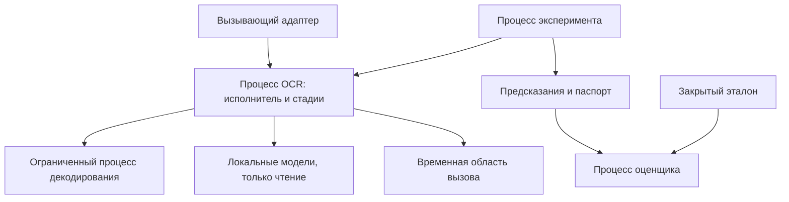

# Части исполнения модуля

Единица поставки – пакет OCR-модуля с адаптерами; модель исполнения предусматривает отдельный ограниченный процесс. Каждый логический компонент не требует собственного сервиса.

| Часть | Состояние | Граница |
|---|---|---|
| Процесс OCR | Загруженные веса, локальный кеш, состояние текущего вычисления | Не хранит долговечные задания |
| Декодер | Один растр и ограниченная рабочая память | Нет доступа к эталону, секретам и сети |
| Исполнитель эксперимента | План, порядок пар, завершенные записи | Не меняет профиль по правильному ответу |
| Оценщик | Эталон и предсказания | Не подключается к конвейеру как источник подсказок |

Для интеграции допускается общая транспортная оболочка с СИРД. Разделение данных и испытательных прав сохраняется независимо от упаковки в процессы или контейнеры.
