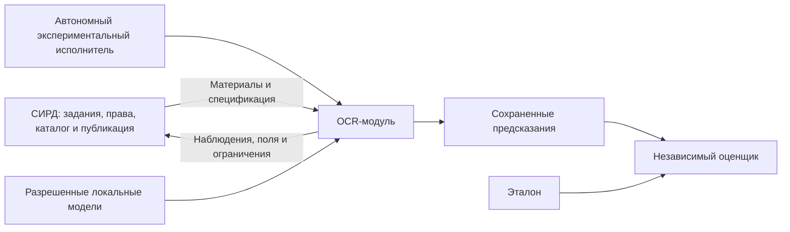

# Контекст OCR-модуля

Модуль получает изображения и план обработки от вызывающей стороны. В рабочем окружении это адаптер СИРД; в эксперименте – автономный исполнитель. Оба используют одинаковые вычислительные порты.

Модуль не опрашивает кадровую базу, не получает заранее введенные реквизиты для исправления OCR и не обращается к публичным реестрам. Связь с чистым оригиналом, доступным разметчику, отсутствует в сквозном эксперименте. Критерии качества и область статьи относятся к данному входу и выбранным полям.

Разработчик OCR отвечает за стадии и экспериментальный интерфейс. Разработчик вызывающей части отвечает за преобразование ее запроса в контракт модуля и интерпретацию ответа. Права разметчика и оценщика не предоставляются рабочему процессу.
