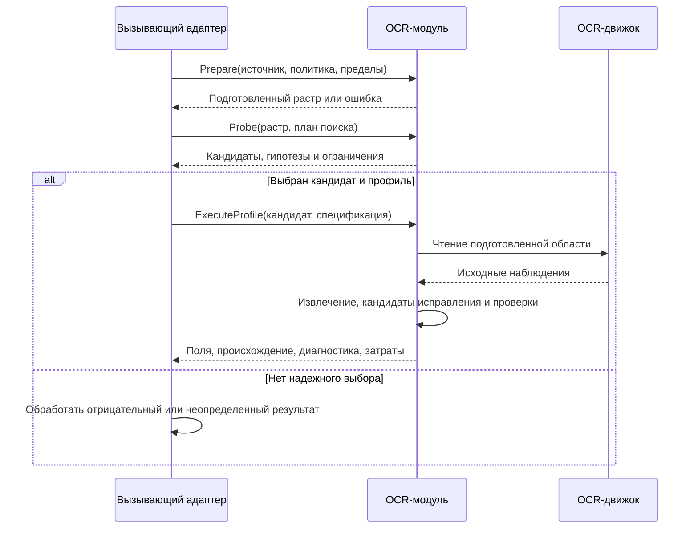
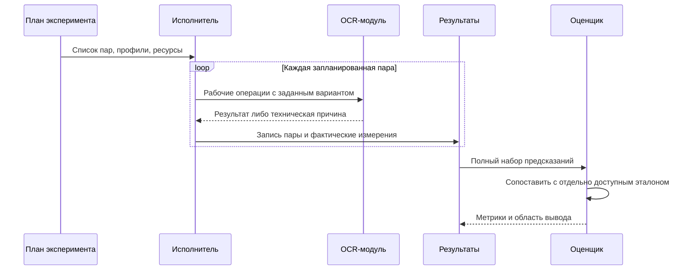

# Потоки обработки и эксперимента

## 1. Интеграционный вызов

СИРД в схеме – внешняя вызывающая сторона. Между Probe и ExecuteProfile она принимает решение по наблюдениям; никакая транзакция ее базы внутри модуля не описывается.

При техническом отказе новая операция не предполагается автоматически. Повторы назначает вызывающая сторона, учитывая причину. Внутреннее повторное чтение поля регулируется пределами исполняемого профиля.

## 2. Эксперимент

План и предсказания фиксируются до сопоставления с закрытым эталоном.

Для компонентного сравнения разрешенные эталонные входы явно записываются как `assistance`. Результат такого сравнения не подменяет оценку сквозного пути. При пересчете метрик вызовы OCR отсутствуют.
