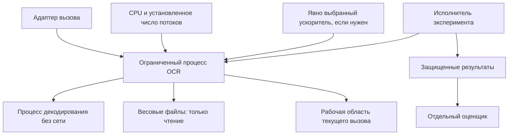

# Среда исполнения OCR-модуля

## Размещение

Предлагается изолированный процесс OCR с локальными моделями, ограниченной временной областью и отдельным декодером. Он может быть встроен в инфраструктуру СИРД через адаптер. Состав ее кластера, очередь и база данных не входят в это представление.

## Ресурсы и измерение

Число процессов, потоков OCR, лимит памяти, размер входного и выходного изображения и бюджет вызовов задаются явно. Нельзя сравнивать два варианта, когда один получил существенно больше CPU-потоков без отражения этого в конфигурации.

При параллельной обработке измеряется суммарная память процессов, общий пул весов и пропускная способность на фактическом профиле размеров. Число реплик выбирается по измерению; масштабирование очереди СИРД не проектируется. Различаются загрузка весов, прогрев и обычный вызов.

## Изоляция

Декодер не читает модели и эталоны. Рабочий OCR не получает каталог эталона. Модели доступны только для чтения, записи ограничены рабочей областью. Сеть по умолчанию не нужна. При использовании удаленного разрешенного хранилища доступ задается адаптером, без передачи полномочий в логи.

Подробная процедура подготовки процесса и отката версии – [эксплуатация](../../operations/deployment.md).
