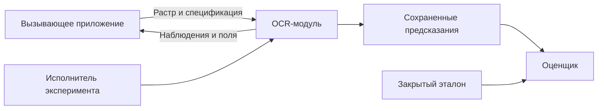

# Спецификация требований к OCR-модулю (SRS)

**Объект:** модуль OCR для бумажных форм СНИЛС. **Редакция:** 0.4. **Состояние:** проект требований.

## История изменений

| Дата | Редакция | Содержание |
|---|---|---|
| 2026-09-16 | 0.4 | Спецификация OCR-модуля, его интерфейсов и экспериментального режима |

## Оглавление

[1. Введение](#srs-1) · [2. Общее описание](#srs-2) · [3. Внешние интерфейсы](#srs-3) · [4. Функциональные возможности](#srs-4) · [5. Нефункциональные требования](#srs-5) · [6. Прочие требования](#srs-6) · [A. Глоссарий](#srs-a) · [B. Аналитические модели](#srs-b).

## 1. Введение

### 1.1. Назначение

Спецификация задает поведение OCR-модуля, его данные и ограничения. Она применяется к обработке изображения и получению полей, а также к запуску контролируемых сравнений технологий. Требования к остальному сервису СИРД не устанавливаются.

### 1.2. Соглашения

Каждое требование имеет устойчивый ID и проверяется через соответствующие тесты. Все сформулированные ниже требования обязательны для заявленного режима. Требования `FR-EXP-*` относятся к экспериментальному запуску; их исполнение не требует добавлять экспериментальные команды в рабочий интерфейс СИРД. Предложенные архитектурные решения отделены от требований и находятся в ADR.

### 1.3. Аудитория

Разработчик OCR использует разделы 3–6 и контракты. Разработчик интеграции – границу модуля и интерфейсы. Проверяющий – требования, [трассируемость](traceability.md) и [план тестирования](../verification/test-plan.md).

### 1.4. Область продукта

Поддерживаются изображения старой карточки СНИЛС, АДИ-РЕГ 2019 и АДИ-РЕГ 2023. Извлекаются номер, ФИО и дата рождения. Допускаются отсутствие цели и неполный результат. Подлинность и принадлежность документа человеку не устанавливаются.

### 1.5. Связанные документы

Потребность и граница описаны в [PRD](../product/PRD.md). Смысл данных – в [модели данных](../architecture/data/data-model.md), операции – в [контракте модуля](../architecture/interfaces/api.md), проверка – в [Test Plan](../verification/test-plan.md). Все необходимые правила приведены в этих документах; внешние шаблоны не являются источником нераскрытых требований.

## 2. Общее описание

### 2.1. Место в окружении

Вызывающее приложение предоставляет разрешенный материал и фиксированную спецификацию обработки. Модуль возвращает наблюдения и поля. Оно же организует долговечное задание, выбирает форму и профиль по наблюдениям и применяет прикладные критерии к результату. Автономный экспериментальный исполнитель заменяет вызывающее приложение локальным контролируемым запуском тех же операций.

### 2.2. Основные функции

Проверка входа; локализация и гипотезы формы; оценка качества; поворот, обрезка, исправление перспективы и масштаба; OCR; извлечение и ограниченная коррекция; локальные проверки; возврат полей и диагностик; раздельное измерение стадий и сохранение результатов эксперимента.

### 2.3. Категории пользователей

Прямые пользователи – разработчик интеграции, разработчик OCR и проверяющий эксперименты. Конечный сотрудник ВШЭ и владелец документа используют внешние приложения. Пользовательские кабинеты не требуются.

### 2.4. Среда эксплуатации

Модуль должен запускаться в выделенном процессе с явно заданными ресурсами. Для CPU-корректора необходим локальный CPU-режим. Устройство выполнения визуальных моделей задается конфигурацией. Реальная модель CPU, объем памяти, версии ОС и библиотек фиксируются в паспорте запуска; наличие конкретного кластера и GPU не предполагается.

### 2.5. Ограничения проектирования

Модуль не должен зависеть от состояния базы СИРД, ее брокера или учетных записей. Профили, исходники и модели передаются через ограниченные интерфейсы. Выбор транспортной оболочки не изменяет смысл результата. Подготовка входа включает декодирование разрешенных форматов и получение растров страниц. Поддержка конкретного контейнера определяется InputPolicy и установленным декодером. Работа с PDF, если он разрешен политикой, ограничивается растеризацией страниц; текстовый слой не используется как источник полей.

### 2.6. Документация пользователя модуля

Для разработчика интеграции предусмотрены контракты и схемы данных. Для Дмитрия и проверяющего – порты стадий, инструкция запуска, корпус, метрики и протокол экспериментов. Отдельная инструкция для кадрового сотрудника не входит в модуль.

### 2.7. Предположения и зависимости

Вызывающая сторона предоставляет разрешенный источник и спецификацию. Для измерения качества нужен размеченный корпус; до его формирования доступны контрактные тесты и синтетические проверки геометрии. Состав допустимых файлов задается `InputPolicy.accepted_media_types` и проверенными декодерами. Фактический формат проверяется по содержимому. Политика приема снимка с экрана не установлена: в исследовании такие примеры имеют отдельную категорию, без утверждения их пригодности для рабочего приема.

## 3. Требования к внешним интерфейсам

### 3.1. Пользовательские интерфейсы

Рабочий модуль предоставляет программные операции. Экспериментальный исполнитель принимает план запуска и сохраняет результаты; графический кабинет и редактор персональных данных не требуются. Формат плана определен в [экспериментальном контракте](../architecture/interfaces/experiment-contract.md).

### 3.2. Аппаратные интерфейсы

Прямое управление камерой и сканером отсутствует. Используются вычислительные ресурсы процесса и, если выбран адаптер с ускорителем, явно выделенное устройство. Параметр CPU-корректора не допускает скрытого переключения на GPU.

### 3.3. Программные интерфейсы

| Операция | Вход | Выход |
|---|---|---|
| `Prepare` | Исходный файл, техническая политика, контекст и пределы | Страницы с растрами, геометрией ориентации и диагностикой; полнота подготовки либо ошибка |
| `Probe` | Подготовленный растр и план поиска | Кандидаты областей, гипотезы форм, качество и ограничения анализа |
| `ExecuteProfile` | Выбранный кандидат, неизменяемая спецификация, материалы | Изображения, OCR-наблюдения, структурированные поля и проверки |
| `RunExperiment` | Версия корпуса без эталона, варианты, лимиты | Запись на каждую пару пример–вариант, паспорт и измерения |
| `Evaluate` | Сохраненные предсказания, эталон и протокол метрик | Числители, знаменатели, интервалы и список ошибок оценивания |

Обязательность полей, типы, состояния и инварианты определены в [API модуля](../architecture/interfaces/api.md) и [модели данных](../architecture/data/data-model.md). Последние две операции принадлежат испытательному приложению.

### 3.4. Коммуникационные интерфейсы

Операции допускают локальный вызов и адаптер интеграции. Внешний HTTP API СИРД, адреса серверов, очередь и гарантия доставки не задаются. Модель не отправляет изображения во внешние публичные API. Контроль разрешенного материала сохраняется при любой оболочке.

## 4. Функциональные возможности

### 4.1. Подготовка входа

**Описание и приоритет:** Высокий. Получить пригодный для анализа растр либо точную причину отказа.

**Воздействия и ответы:** Получен источник → проверены тип и пределы → получены растры разрешенных страниц и учтена ориентация → возвращены страницы и полнота подготовки.

#### FR-OCR-001 – Проверка входа

**Требование:** Модуль должен проверять фактический формат, декодируемость, размер, число страниц и число пикселей по переданной InputPolicy. Подготовленные страницы должны сохранять связь с файлом и порядок. Неполная подготовка должна содержать причину и не выдаваться за полный анализ файла. Недопустимый файл возвращает контролируемую причину без результата поиска документа.

**Основание:** Повреждение файла не означает отсутствие СНИЛС.

**Проверка:** [TEST-OCR-001](../verification/test-cases.md#test-ocr-001), [TEST-OCR-002](../verification/test-cases.md#test-ocr-002).

### 4.2. Поиск и различение форм

**Описание и приоритет:** Высокий. Сохранить корректное отрицательное и неоднозначное поведение.

**Воздействия и ответы:** Передан подготовленный растр → получены кандидаты → возвращены гипотезы форм и ограничения; внешняя сторона выбирает профиль.

#### FR-OCR-002 – Отсутствие и неопределенность объекта

**Требование:** Поиск должен возвращать области кандидатов и различать обнаружение, отсутствие обнаружений при завершенном анализе и неопределенность. Ошибка или исчерпание бюджета анализа не могут возвращаться как уверенное отсутствие объекта.

**Основание:** В кадре может не быть целевого документа.

**Проверка:** [TEST-OCR-003](../verification/test-cases.md#test-ocr-003).

#### FR-OCR-003 – Несколько объектов

**Требование:** Наблюдения и поля разных кандидатов должны иметь разные candidate_id. Без явного выбора одного объекта или разрешенного режима раздельной обработки модуль не должен объединять поля нескольких документов.

**Основание:** Защита от смешения данных.

**Проверка:** [TEST-OCR-004](../verification/test-cases.md#test-ocr-004).

#### FR-OCR-004 – Форма документа

**Требование:** Модуль должен получать гипотезы о трех поддерживаемых формах и возвращать их основания. Выполнение заданного профиля должно сохранять его form_id и диагностику несоответствия наблюдениям; отсутствие формы не заменяется произвольным профилем.

**Основание:** Сохранение различия наблюдаемой формы и решения вызывающего приложения.

**Проверка:** [TEST-OCR-005](../verification/test-cases.md#test-ocr-005).

### 4.3. Геометрия и качество

**Описание и приоритет:** Высокий. Сохранить читаемые области и их связь с оригиналом.

**Воздействия и ответы:** Переданы кандидат и профиль → измерены дефекты → применены разрешенные операции → сохранены материалы и параметры.

#### FR-OCR-005 – Ориентация и геометрия

**Требование:** Модуль должен отдельно учитывать ориентацию метаданных, поворот документа на четверть оборота, перспективу и остаточный наклон. Для примененного преобразования сохраняются исходная и выходная системы координат, параметры и доступная область исходных пикселей.

**Основание:** Поля должны сопоставляться с исходной фотографией.

**Проверка:** [TEST-OCR-006](../verification/test-cases.md#test-ocr-006), [TEST-OCR-007](../verification/test-cases.md#test-ocr-007).

#### FR-OCR-006 – Измерение качества

**Требование:** Каждое измерение качества должно содержать область, масштаб, алгоритм, единицу и результат. При невозможности измерения возвращается not_measured с причиной, без подстановки нулевого дефекта.

**Основание:** Неизмеренное качество не равно хорошему.

**Проверка:** [TEST-OCR-008](../verification/test-cases.md#test-ocr-008).

#### FR-OCR-007 – Управляемая предобработка

**Требование:** Должен существовать путь без необязательных улучшений. Каждая дополнительная обработка и повторное чтение допускаются только профилем с конечным бюджетом и фиксируются в истории материала.

**Основание:** Изменение изображения может ухудшить чтение.

**Проверка:** [TEST-OCR-009](../verification/test-cases.md#test-ocr-009), [TEST-OCR-016](../verification/test-cases.md#test-ocr-016).

### 4.4. Чтение и структурированные поля

**Описание и приоритет:** Высокий. Вернуть наблюдаемое содержание без неподдержанной подмены.

**Воздействия и ответы:** Прочитан растр → выделены поля → сформированы и проверены гипотезы → возвращены значения или состояния отсутствия.

#### FR-OCR-008 – Наблюдения OCR

**Требование:** OCR должен возвращать исходный текст и фактически доступные координаты, оценки и альтернативы. Отсутствующая возможность адаптера отмечается явно; искусственные координаты и вероятности запрещены.

**Основание:** Наблюдение должно сохранять смысл результата движка.

**Проверка:** [TEST-OCR-010](../verification/test-cases.md#test-ocr-010).

#### FR-OCR-009 – Извлечение полей

**Требование:** Для выбранного документа модуль должен формировать snils, full_name и birth_date с состоянием, значением либо null, ссылками на наблюдения и локальными проверками. Дополнительные поля не становятся обязательными без расширения версии схемы.

**Основание:** Общий выход для разных форм и движков.

**Проверка:** [TEST-OCR-011](../verification/test-cases.md#test-ocr-011).

#### FR-OCR-010 – Нормализация и коррекция

**Требование:** Модуль должен сохранять raw_value. Разрешенное форматирование записывается отдельно от замены предполагаемого символа; для каждой коррекции сохраняются исходный и новый фрагменты, метод и поддерживающие наблюдения.

**Основание:** Изменения персональных данных должны быть объяснимы по входу.

**Проверка:** [TEST-OCR-012](../verification/test-cases.md#test-ocr-012).

#### FR-OCR-011 – Ограничение исправлений

**Требование:** Корректор должен возвращать кандидатов, которые проходят полевую политику. Языковая правдоподобность, существующая дата или контрольное число сами по себе не дают основания заменить значение; неподтвержденная гипотеза не становится выбранным полем.

**Основание:** Недопущение правдоподобной подмены.

**Проверка:** [TEST-OCR-012](../verification/test-cases.md#test-ocr-012), [TEST-OCR-013](../verification/test-cases.md#test-ocr-013).

#### FR-OCR-012 – Частичность и конфликт

**Требование:** Модуль должен возвращать доступные подтвержденные поля при нечитаемости остальных и сохранять конфликт сопоставимых гипотез. Повтор чтения тех же пикселей не считается независимым подтверждением.

**Основание:** Не терять читаемые поля и не завышать уверенность.

**Проверка:** [TEST-OCR-013](../verification/test-cases.md#test-ocr-013), [TEST-OCR-014](../verification/test-cases.md#test-ocr-014).

#### FR-OCR-013 – Формальные проверки

**Требование:** Формат, календарная допустимость и проверка контрольного числа должны возвращать rule_id, версию, применимость и исход. Неприменимая или неисполненная проверка не может иметь результат valid.

**Основание:** Проверка должна быть отделена от истинности чтения.

**Проверка:** [TEST-OCR-015](../verification/test-cases.md#test-ocr-015).

### 4.5. Исполнение и интеграция

**Описание и приоритет:** Высокий. Ограничивать вычисления и сохранять примененную конфигурацию.

**Воздействия и ответы:** Проверены версии и бюджет → выполнены стадии → при завершении или остановке возвращены фактические сведения и освобождены ресурсы.

#### FR-OCR-014 – Ограничение исполнения

**Требование:** Модуль должен соблюдать конечные пределы времени, памяти, числа вариантов и вызовов моделей. Остановка должна возвращать причину и только результаты завершенных стадий; ресурсы временного исполнения освобождаются.

**Основание:** Стоимость каскада должна быть измеримой и ограниченной.

**Проверка:** [TEST-OCR-016](../verification/test-cases.md#test-ocr-016), [TEST-OCR-021](../verification/test-cases.md#test-ocr-021).

#### FR-OCR-015 – Фактическая конфигурация

**Требование:** В результате должны быть зафиксированы запрошенные и примененные версии кода, политик, моделей и схемы. Несовместимая или недоступная реализация должна приводить к явному исходу, без скрытой замены другой моделью.

**Основание:** Предсказание должно относиться к известному варианту.

**Проверка:** [TEST-OCR-017](../verification/test-cases.md#test-ocr-017).

#### FR-OCR-016 – Контракт интеграции

**Требование:** Prepare, Probe и ExecuteProfile должны вызываться без базы и очереди СИРД при переданных материалах и спецификации. Ответ не должен назначать статус долговечного задания или решение о принятии документа.

**Основание:** Автономная разработка OCR-модуля.

**Проверка:** [TEST-OCR-018](../verification/test-cases.md#test-ocr-018).

### 4.6. Экспериментальный режим

**Описание и приоритет:** Высокий для экспериментального приложения. Поддержать сравнимые и проверяемые измерения.

**Воздействия и ответы:** Разрешен план эксперимента → выполнены все назначенные пары → результаты сохранены → независимый оценщик сопоставил их с эталоном.

#### FR-EXP-001 – Смена и отключение стадий

**Требование:** Экспериментальный запуск должен выбирать адаптеры по идентификаторам и включать или отключать разрешенные стадии без изменения кода остальных стадий. Должен сохраняться полностью разрешенный профиль, включая значения по умолчанию.

**Основание:** Выделение вклада технологий.

**Проверка:** [TEST-OCR-019](../verification/test-cases.md#test-ocr-019).

#### FR-EXP-002 – Результат каждого примера

**Требование:** Эксперимент должен сохранять отдельный результат для каждой запланированной пары sample_id и variant_id, включая ошибку, остановку и пропуск с причиной. Агрегат без таких записей не считается завершенным измерением.

**Основание:** Неудачные примеры не должны исчезать из знаменателя.

**Проверка:** [TEST-OCR-020](../verification/test-cases.md#test-ocr-020).

#### FR-EXP-003 – Изоляция эталона

**Требование:** Рабочие стадии и сквозной эксперимент не должны получать эталонные значения, правильные углы или правильную форму. Подстановка допускается только в помеченном компонентном режиме и отражается в результате.

**Основание:** Защита от утечки правильного ответа.

**Проверка:** [TEST-OCR-022](../verification/test-cases.md#test-ocr-022).

#### FR-EXP-004 – Повторный расчет

**Требование:** Оценщик должен вычислять метрики заново по сохраненным предсказаниям и эталону без повторного OCR. Результат содержит версию оценщика, нормализации, числители, знаменатели и список исключений.

**Основание:** Независимая проверка выводов статьи.

**Проверка:** [TEST-OCR-023](../verification/test-cases.md#test-ocr-023).

#### FR-EXP-005 – Измерение затрат

**Требование:** Запуск должен отдельно измерять холодный старт, прогретое выполнение, время стадий, число вызовов, память и технические исходы. Затраты повторов и обработки вариантов включаются в стоимость результата.

**Основание:** Выбор с учетом ограничений среды.

**Проверка:** [TEST-OCR-024](../verification/test-cases.md#test-ocr-024).

## 5. Другие нефункциональные требования

### 5.1. Производительность

`ExecutionLimits` задает время одного вызова, число OCR-попыток, число подготовленных вариантов, потоки и память. Эти пределы обязательны и конечны; отсутствие предела является ошибкой конфигурации. Проверяется соблюдение конкретных переданных пределов.

Предельная задержка штатного OCR и допустимая память поставки еще не согласованы. Для приемочного сравнения они записываются в критерий до запуска; измерение без согласованной границы дает характеристику, но не утверждение о соответствии. Срок работы сотрудника и суточная нагрузка всего сервиса не являются метриками данного модуля.

### 5.2. Безопасность применения

Недоступные символы не восстанавливаются по правдоподобию. Контрольное число СНИЛС и допустимая дата возвращаются как формальные проверки. Подлинность, юридическая действительность и принадлежность человеку не подтверждаются. Требования FR-OCR-010–FR-OCR-013 определяют проверяемые ограничения.

### 5.3. Информационная безопасность

#### SEC-OCR-001 – Изоляция декодирования

**Требование:** Декодер недоверенного растра должен выполняться с ограничением ресурсов и без исходящей сети. Он не должен получать каталог моделей, эталоны и секреты интеграции.

**Основание:** Локализация воздействия поврежденного входа.

**Проверка:** [TEST-OCR-002](../verification/test-cases.md#test-ocr-002), [TEST-OCR-021](../verification/test-cases.md#test-ocr-021).

#### SEC-OCR-002 – Данные в диагностике

**Требование:** Общие журналы, метрики и сообщения об ошибках не должны содержать изображения, персональные значения, секреты и временные полномочия доступа. Промежуточные материалы сохраняются только в разрешенном режиме.

**Основание:** Диагностика без распространения реквизитов.

**Проверка:** [TEST-OCR-021](../verification/test-cases.md#test-ocr-021).

#### SEC-OCR-003 – Загрузка реализаций

**Требование:** Исполнение должно использовать разрешенные локальные модели и адаптеры с проверенными идентификаторами и контрольными суммами. Содержимое документа и запрос потребителя не могут назначать произвольный адрес, код или модель для загрузки.

**Основание:** Защита исполнения и воспроизводимость.

**Проверка:** [TEST-OCR-017](../verification/test-cases.md#test-ocr-017), [TEST-OCR-021](../verification/test-cases.md#test-ocr-021).

#### SEC-OCR-004 – Разделение материалов

**Требование:** Доступ к исходникам, временным данным и эталону должен ограничиваться назначением текущего запуска. После завершения или остановки временные материалы удаляются по установленной политике; рабочие документы не включаются в обучение автоматически.

**Основание:** Сохранение границы корпуса и рабочего потока.

**Проверка:** [TEST-OCR-021](../verification/test-cases.md#test-ocr-021), [TEST-OCR-022](../verification/test-cases.md#test-ocr-022).

### 5.4. Атрибуты качества

#### NFR-OCR-001 – Изменяемость реализаций

**Требование:** Добавление адаптера к существующему порту должно проходить контрактные тесты без изменения потребительской схемы полей. Необходимые расширения возможностей явно версионируются.

**Основание:** Сравнение и последующая замена технологий.

**Проверка:** [TEST-OCR-010](../verification/test-cases.md#test-ocr-010), [TEST-OCR-019](../verification/test-cases.md#test-ocr-019).

#### NFR-OCR-002 – Интерпретация уверенности

**Требование:** Вероятность правильности допускается только со ссылкой на калибровку для данной модели, профиля и задачи. При отсутствии применимой калибровки probability равна null, исходная оценка сохраняется в собственной шкале.

**Основание:** Отсутствие вымышленных вероятностей.

**Проверка:** [TEST-OCR-017](../verification/test-cases.md#test-ocr-017), [TEST-OCR-025](../verification/test-cases.md#test-ocr-025).

#### NFR-OCR-003 – Воспроизводимость

**Требование:** Зафиксированные вход, профиль и среда должны позволять повторить запуск. Для недетерминированных операций сохраняются семена и параметры исполнения; допустимость отличий определяется критерием конкретного эксперимента.

**Основание:** Повторяемость без обещания побитового равенства любых моделей.

**Проверка:** [TEST-OCR-019](../verification/test-cases.md#test-ocr-019), [TEST-OCR-020](../verification/test-cases.md#test-ocr-020).

#### NFR-OCR-004 – Качество в условиях применения

**Требование:** Итоговая оценка должна учитывать точное извлечение полей, ошибочную выдачу, отказы и порчу правильных значений раздельно по форме и качеству входа. Соответствие JSON-схеме и прохождение валидатора не заменяют проверку по эталону.

**Основание:** Измерять прикладной результат.

**Проверка:** [TEST-OCR-023](../verification/test-cases.md#test-ocr-023), [TEST-OCR-025](../verification/test-cases.md#test-ocr-025).

### 5.5. Правила предметной области

`snils` представляет 11 цифр без форматных разделителей; исходное написание хранится отдельно. `full_name` представляет видимое ФИО целиком, без обязательного предположения о трех словах. `birth_date` при однозначном чтении представляется календарной датой `YYYY-MM-DD`.

Состояния поля и формальные проверки независимы. Правильно прочитанный текст с ошибочным контрольным числом может иметь `status=extracted` и отрицательную проверку. Нечитаемость не означает `not_applicable`.

## 6. Прочие требования

### 6.1. Ограничение вычислительного режима

#### CON-OCR-001 – Локальная коррекция на CPU

**Требование:** Все сравниваемые текстовые корректоры должны испытываться в локальном CPU-режиме с зафиксированным числом потоков. Для OCR и визуальных моделей устройство задается явно и не наследуется из этого ограничения.

**Основание:** Согласованное ограничение на корректоры.

**Проверка:** [TEST-OCR-024](../verification/test-cases.md#test-ocr-024).

### 6.2. Хранение и повторное использование

Модуль не владеет базой заданий и не хранит окончательные ответы СИРД. Исходные и промежуточные материалы имеют режим доступа и срок хранения, определенные вызывающей стороной. Экспериментальный исполнитель сохраняет разрешенные материалы с версиями для повторного вычисления метрик. Веса моделей и реальные персональные документы не включаются в общедоступные результаты автоматически.

### 6.3. Согласование изменений

Дмитрий отвечает за требования к модулю. Изменение входов и выходов рассматривается вместе с разработчиком интеграции; изменение метрик и эталона – с независимым проверяющим. Назначение моделей и численных критериев оформляется после измерений. Согласование этой редакции не зарегистрировано.

## Приложение A. Глоссарий

[Глоссарий модуля](../glossary.md) задает значения наблюдения, гипотезы, проверки, формы, профиля и независимого эксперимента.

## Приложение B. Аналитические модели

Внешнее поведение включает обработку изображения и независимое оценивание результатов. Эталон не входит в допустимый вход распознавания.

Модель не задает транспорт или устройство внутреннего конвейера. Они описаны в архитектуре.
